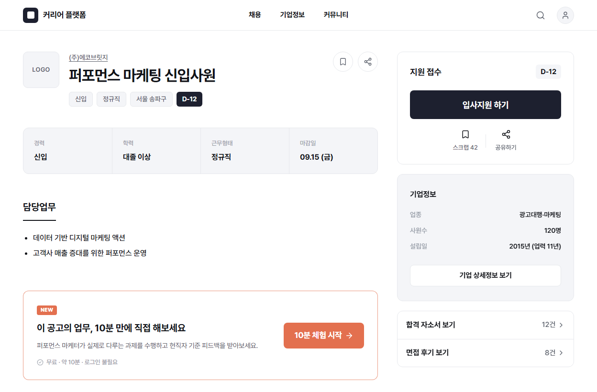
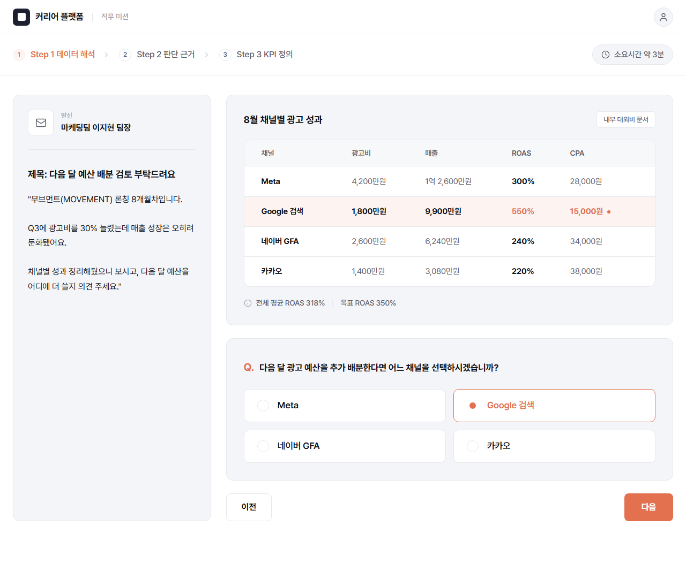
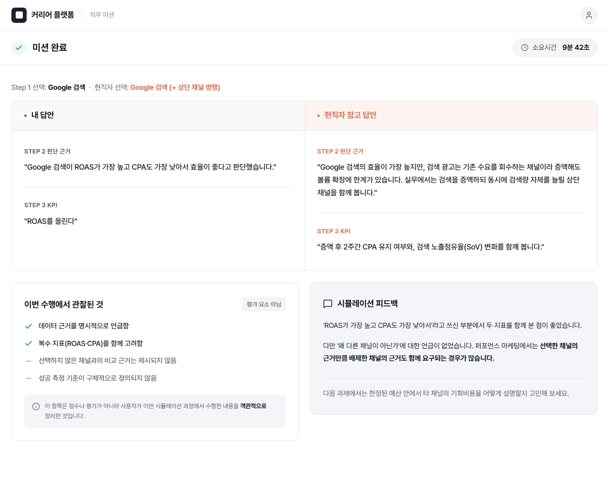

# Job Mission — 채용공고에서 10분 직무 체험

**채용공고를 읽기만 하는 대신, 그 공고의 실제 업무를 10분 만에 직접 해보고 현직자 기준 피드백을 받는 웹 프로토타입입니다.**

- 배포 URL: https://job-mission-web.vercel.app
- 퍼널 대시보드: https://job-mission-web.vercel.app/admin/funnel

> 서비스 기획·PO 포트폴리오용 프로토타입입니다. 서비스명 "커리어 플랫폼", 회사 "(주)에코브릿지", 브랜드 "무브먼트(MOVEMENT)"는 모두 가상입니다.

## 왜 만들었나

- **대상:** 관심 직군(마케팅)은 정했지만 세부 직무(퍼포먼스/브랜드 등)를 아직 정하지 못한 대학 4학년·졸업 직전 학생
- **가설:** 직무 설명을 읽는 것보다 직접 과제를 해보는 경험이 직무 이해와 다음 행동(지원·스크랩)을 높인다.

## 주요 화면

### 1. 공고 상세: 체험 진입점
공고 본문 아래 "이 공고의 업무, 10분 만에 직접 해보세요" 카드에서 체험을 시작합니다.



### 2. 미션 수행: 3단계 과제
팀장 메시지와 실제 업무 자료(채널별 광고 성과)를 보고 Step 1 선택 → Step 2 판단 근거 → Step 3 KPI 정의 순서로 답합니다. 브랜드 마케터 미션은 같은 화면을 테마색(초록)만 바꿔 씁니다.



### 3. 결과 피드백: 점수 없는 관찰
내 답안을 현직자 참고 답안과 나란히 비교하고, 이번 답안에서 관찰된 것과 다음 과제에서 해볼 점을 보여줍니다.



## 핵심 설계 원칙

### 점수 없는 관찰 피드백
- **점수·등급·적합도 퍼센트를 어디에도 표시하지 않습니다.** 짧은 체험 한 번으로 "당신은 이 직무에 87% 적합합니다"라고 단정하면 오히려 탐색을 막습니다.
- 피드백은 "관찰된 것"(✓)과 "이번 답안에서 보이지 않은 것"(–)으로만 표현합니다. 미충족 문구도 평가가 아니라 관찰로 씁니다. 예: "부족합니다"가 아니라 "이번 답안에서는 … 보이지 않았습니다".
- **외부 AI 없이 루브릭 규칙으로 판정합니다.** 배포 비용과 API 키 노출이 없고, 같은 답안에는 항상 같은 결과가 나옵니다. 관찰 항목은 네 가지입니다.

  | 관찰 항목 | 판정 기준 (Step 2·3 답안) |
  |---|---|
  | 데이터 근거를 명시적으로 언급함 | 숫자나 지표명이 1개 이상 |
  | 복수 지표를 함께 고려함 | 서로 다른 지표가 2개 이상 (브랜드: 인지 계열과 구매 계열) |
  | 선택하지 않은 선택지와의 비교 근거 | 고르지 않은 선택지가 답안에 등장 |
  | 성공 측정 기준을 구체적으로 정의함 | Step 3에 기간과 지표가 모두 있음 |

- 판정 로직은 `lib/feedback.ts`의 `generateFeedback(answers, rubric)` 하나로 분리했습니다. 나중에 실제 LLM으로 바꿀 때 이 함수만 교체하면 됩니다.

### 이벤트 퍼널로 가설 측정
- 공고 노출부터 지원 클릭까지 10단계 이벤트를 기록하고 `/admin/funnel`에서 단계별 전환을 봅니다.

  `CTA 노출 → CTA 클릭 → 미션 시작 → Step 1·2·3 완료 → 제출 → 피드백 확인 → 공고 다시 보기 → 스크랩·지원 클릭`

- **세션(브라우저 탭) 기준으로 셉니다.** 새로고침이나 이전/다음 왕복으로 같은 이벤트가 여러 번 찍혀도 한 번으로 셉니다.
- 목표 가설치를 함께 표시합니다(`data/kpi.ts`).
  - CTA 노출 → CTA 클릭: 2~4%
  - 완주율(미션 시작 → 피드백 확인): 25~35%
- 서버 없이 이 브라우저의 기록만 보여주는 데모입니다. "데모 데이터 채우기"로 가짜 세션 5,000개를 넣어 볼 수 있고, 화면에 가짜 데이터임을 표시합니다.

## 화면 구성

| 경로 | 화면 |
|---|---|
| `/` | `/jobs/performance-marketing`으로 이동 |
| `/jobs/[jobId]` | 공고 상세 (퍼포먼스·브랜드 마케터) |
| `/missions` | 직군 탐색 → 세부 직무 선택 |
| `/missions/[jobId]/brief` | 미션 브리프 |
| `/missions/[jobId]/play?step=1~3` | 미션 수행 |
| `/missions/[jobId]/result` | 결과 피드백과 다음 행동 |
| `/admin/funnel` | 이벤트 퍼널 대시보드 |

1024px 이상 화면을 기준으로 만들었고, 그보다 좁으면 "PC에서 이용해 주세요" 안내가 나옵니다.

## 실행 방법

Node.js 20 이상이 필요합니다. (루브릭 단위 테스트 `test-rubric.mts`는 TypeScript를 바로 실행하므로 Node.js 22.18 이상)

```bash
npm install
npm run dev          # http://localhost:3000
```

프로덕션 빌드:

```bash
npm run build
npm start
```

### 검증 스크립트

브라우저 검증 스크립트는 개발 서버가 3100 포트에서 떠 있다고 가정합니다(`BASE_URL`로 바꿀 수 있음).

```bash
npx playwright install chromium     # 처음 한 번
npm run dev -- -p 3100              # 다른 터미널에서

node scripts/test-rubric.mts        # 루브릭 판정 단위 테스트 (서버 불필요)
node scripts/verify-journey.mjs     # 공고 → 미션 → 결과 → 다음 행동 전체 여정
node scripts/verify-result.mjs      # 테스트 답안으로 관찰 항목 ✓✓–– 확인
node scripts/verify-funnel.mjs      # 체험 기록이 퍼널에 잡히는지
node scripts/verify-responsive.mjs  # 1024px 레이아웃과 좁은 화면 안내
```

## 기술 스택

Next.js 16 (App Router) · TypeScript · Tailwind CSS 4 · Pretendard · lucide-react · localStorage(답안·이벤트 저장, DB 없음) · Playwright(검증) · Vercel(배포)

## 폴더 구조

```
app/          화면 (공고, 직군 탐색, 브리프, 수행, 결과, 퍼널)
components/   화면 조각 (Header, StepBar, DataTable, AnswerCompare, FunnelDashboard …)
data/         콘텐츠와 규칙 (jobs, missions, feedback 루브릭·문구, kpi 목표치)
lib/          이벤트 로깅, 진행 상태, 루브릭 판정, 퍼널 집계
reference/    디자인 기준 스크린샷 4장
docs/images/  README 스크린샷
scripts/      Playwright 캡처·검증 스크립트
job_mission.md  구현 명세서
```
